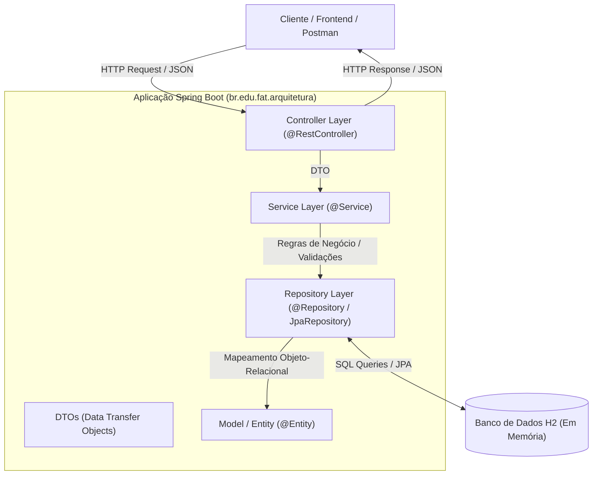

# FAT Arquitetura - Delivery API

Projeto desenvolvido para a disciplina de **Arquitetura de Software** (FAT), implementando uma **API RESTful** para um sistema de **Delivery de Entregas e Pedidos** (*DeliveryTech*), utilizando o ecossistema **Java 21 LTS** e **Spring Boot 3**.

---

## 📌 Contexto do Projeto

O objetivo do projeto é demonstrar a aplicação prática de padrões de **Arquitetura de Software** no desenvolvimento de uma API robusta, desacoplada e escalável para gerenciamento de serviços de entrega:
* **Cadastro e Consulta** de clientes, restaurantes e itens do catálogo.
* **Ciclo de Vida de Pedidos** (criação, cálculo, atualização de status e despacho).
* **Gestão de Entregas** e rastreamento.
* **Persistência de Dados** relacional e boas práticas de modelagem de domínio.

---

## 🛠️ Tecnologias Utilizadas

* **Linguagem:** Java 21 LTS (Eclipse Temurin)
* **Framework:** Spring Boot 3.3.4
  * **Spring Web:** Criação de endpoints HTTP e controladores RESTful (`@RestController`).
  * **Spring Data JPA:** Camada de persistência relacional com Hibernate e `JpaRepository`.
  * **Spring Boot DevTools:** Recarregamento dinâmico (*LiveReload*) em ambiente de desenvolvimento.
* **Banco de Dados:** H2 Database (banco de dados relacional em memória com console web).
* **Produtividade:** Project Lombok (redução de código boilerplate: getters, setters, construtores).
* **Gerenciador de Dependências:** Apache Maven 3.9+ com Maven Wrapper (`mvnw`).

---

## 🏗️ Estrutura Arquitetural

A aplicação segue uma **Arquitetura em Camadas** (*Layered Architecture*), promovendo alta coesão e baixo acoplamento:



### Divisão de Pacotes:
* `br.edu.fat.arquitetura`: Classe principal da aplicação (`FatArquiteturaApplication`).
* `br.edu.fat.arquitetura.controller`: Camada de exposição dos endpoints HTTP.
* `br.edu.fat.arquitetura.service`: Camada de lógica de negócio e orquestração.
* `br.edu.fat.arquitetura.repository`: Camada de acesso a dados (Spring Data JPA).
* `br.edu.fat.arquitetura.model`: Entidades JPA de banco de dados.
* `br.edu.fat.arquitetura.dto`: Objetos de transporte de dados de entrada e saída.

---

## ⚙️ Configurações do Ambiente

### 1. Pré-requisitos
* **Java 21 LTS** instalado (`java -version`).
* Variável de ambiente `JAVA_HOME` configurada.

### 2. Acesso ao Banco de Dados H2
O projeto utiliza um banco em memória configurado em `src/main/resources/application.properties`:
* **Console Web do H2:** [http://localhost:8080/h2-console](http://localhost:8080/h2-console)
* **JDBC URL:** `jdbc:h2:mem:fatdb`
* **Usuário:** `sa`
* **Senha:** *(em branco)*

---

## 🚀 Como Executar o Projeto

Clone o repositório:
```bash
git clone https://github.com/rocdav/FAT_arquitetura.git
cd FAT_arquitetura
```

### Usando o Maven Wrapper (Sem necessidade de instalar o Maven manualmente):

* **Windows (PowerShell ou CMD):**
  ```powershell
  .\mvnw.cmd spring-boot:run
  ```

* **Linux / macOS:**
  ```bash
  ./mvnw spring-boot:run
  ```

### Para Compilar e Gerar o Pacote JAR:
```bash
.\mvnw.cmd clean package
```
O executável será gerado em `target/fat-arquitetura-1.0-SNAPSHOT.jar`.
